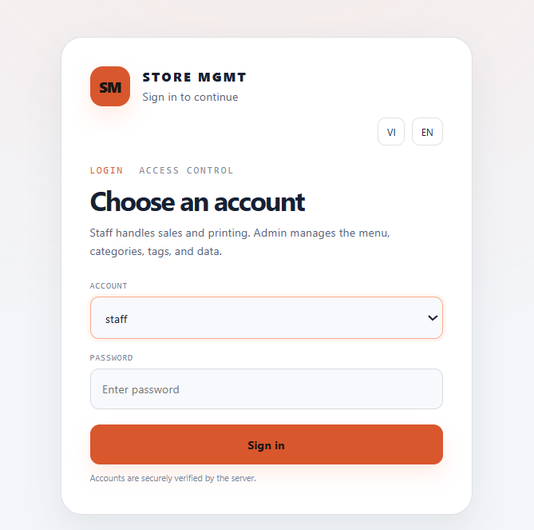
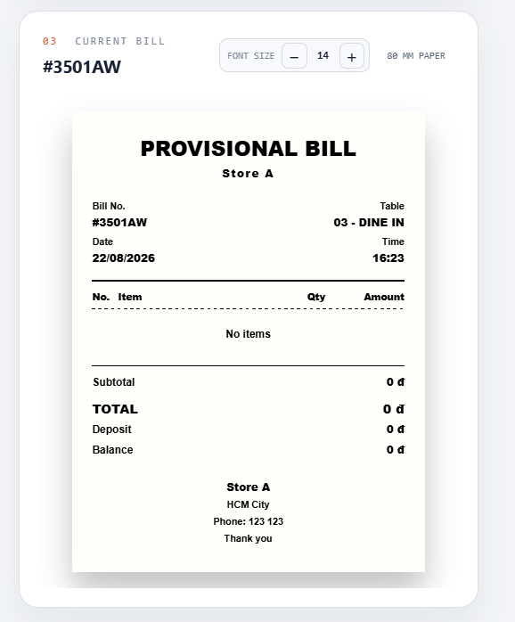
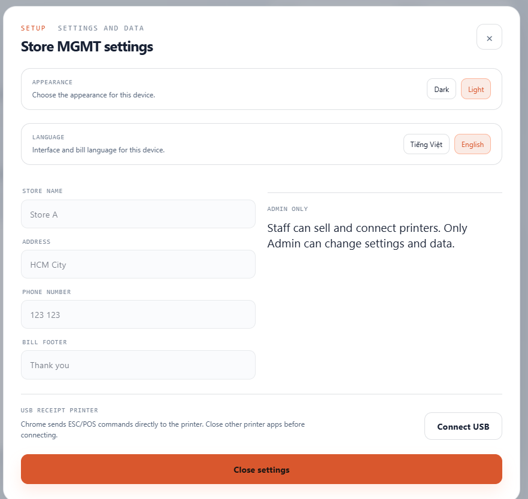
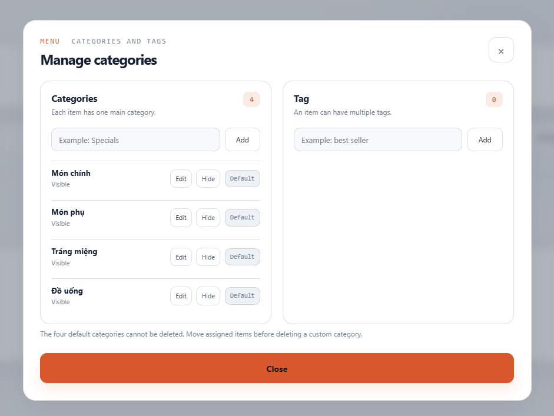

[Tiếng Việt](README.md) | [English](README.en.md)

# Store MGMT Community Edition

[](https://github.com/atgsolution/store-mgmt-community/actions/workflows/docker-smoke.yml)
[](LICENSE)

**A self-hosted point-of-sale and store operations platform.**

Store MGMT Community Edition is a free community release for stores that require centralized sales and operational data on self-managed infrastructure.

## Capabilities

- Touch-first sales workflow for computers and tablets.
- Product, category, tag, price, and availability management.
- Table, service type, deposit, discount, and payment management.
- Staff/Admin authorization, immutable paid orders, and administrative audit logs.
- Daily, monthly, and yearly revenue; payment mix; top products; opening and closing cash.
- 80 mm thermal receipt printing from the browser when the device recognizes the printer, with direct WebUSB ESC/POS support.
- Vietnamese and English interfaces and receipts with UTF-8 application data.

## System profile

| Property | Design |
|---|---|
| Scope | One store per deployment |
| Source of truth | Shared PostgreSQL data for all authenticated sessions |
| Retention | 60-day operational store, archive database, and cold archive |
| Sessions | Up to 10 sessions per account with a seven-day lifetime |
| Deployment | Docker Compose with separate web, API, archive worker, and database services |
| Printing | Browser print dialog or direct WebUSB ESC/POS |

## Product tour

| Sign-in and access control | 80 mm receipt preview |
|---|---|
|  |  |
| Store settings | Category and tag management |
|  |  |

## First-time Linux installation

Requires Docker Engine, Docker Compose v2, Git, and OpenSSL.

### 1. Download the source

```bash
git clone https://github.com/atgsolution/store-mgmt-community.git
cd store-mgmt-community
```

### 2. Create the initial passwords

```bash
bash scripts/setup-linux.sh
```

The script prompts for passwords for two fixed accounts:

- `admin`: system, catalog, data, and account administration.
- `staff`: sales, order management, and receipt printing.

The terminal intentionally displays **no characters or `*` symbols** while a password is entered. Type the password and press Enter. Each password must contain at least eight characters, including a letter, a number, and a special character, with no spaces.

There are no public default passwords. The script generates unique database secrets and writes only scrypt account-password hashes to `.env`.

### 3. Start the application

```bash
docker compose config --quiet
docker compose up -d --build
docker compose ps
```

### 4. Sign in

Open `http://localhost:6086` on the server or `http://<server-address>:6086` from another device on the same network.

| Role | Username | Password |
|---|---|---|
| Administrator | `admin` | The Admin password selected in step 2 |
| Staff | `staff` | The Staff password selected in step 2 |

The application health endpoint is `/healthz`.

## Change a password

Only `admin` can change account passwords:

1. Sign in as `admin`.
2. Open the **Users** tab.
3. Enter and confirm the new password in the `admin` or `staff` card.
4. Select **Change password**.

Changing the Staff password revokes all active Staff sessions. When an Admin changes their own password, the current session remains active and all other Admin sessions are revoked.

## Recover a forgotten password

If no Admin session is available, run the following command from the project directory on the server:

```bash
bash scripts/reset-password.sh admin
```

To reset the Staff password:

```bash
bash scripts/reset-password.sh staff
```

The containers must be running. The command updates only the selected account, revokes its existing sessions, and records an audit entry; it does not remove orders, catalog data, or store settings.

## Upgrades

```bash
git pull --ff-only
docker compose up -d --build --remove-orphans
docker compose ps
```

Recreating containers does not remove Docker data volumes. Never run `docker compose down -v` on a deployment whose data must be preserved.

## Backup

```bash
docker compose exec -T hot-db \
  pg_dump -U store_mgmt -d store_mgmt_hot > hot-backup.sql

docker compose exec -T archive-db \
  pg_dump -U store_mgmt -d store_mgmt_archive > archive-backup.sql
```

A complete recovery set contains both database dumps and the cold-archive volume. A backup is valid only after a successful restore test.

## Security

- Passwords use scrypt with random salts; changing a password revokes the remaining sessions.
- Production must run behind an HTTPS reverse proxy with `COOKIE_SECURE=true`.
- Access control and business rules are enforced by the API.

## Scope limits

The Community Edition supports one store per deployment. Multi-store operation, multi-tenant hosting, electronic invoicing, and accounting integrations are outside the current scope.

## Documentation

- [Software architecture](docs/architecture.en.md)
- [Data architecture and lifecycle](docs/database.en.md)
- [Thermal printing architecture](docs/printer-setup.en.md)

## Community and license

- [Contributing guide](CONTRIBUTING.md)
- [Security policy](SECURITY.md)
- [Code of conduct](CODE_OF_CONDUCT.md)
- Released under the [Apache License 2.0](LICENSE).
