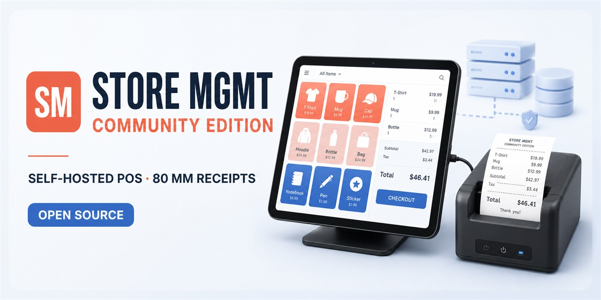

[Tiếng Việt](README.md) | [English](README.en.md)

# Store MGMT Community Edition

[](https://github.com/atgsolution/store-mgmt-community/actions/workflows/docker-smoke.yml)
[](LICENSE)



[Bản phát hành mới nhất](https://github.com/atgsolution/store-mgmt-community/releases/latest) · [Cài đặt](#cài-đặt-lần-đầu-trên-linux) · [Lộ trình](ROADMAP.md) · [Thảo luận](https://github.com/atgsolution/store-mgmt-community/discussions)

**Nền tảng bán hàng và quản lý cửa hàng self-hosted.**

Store MGMT Community Edition là phiên bản miễn phí dành cho cộng đồng, phù hợp với cửa hàng cần quản lý bán hàng và dữ liệu tập trung trên hệ thống riêng.

Nếu Store MGMT hữu ích với bạn, hãy [Star repo](https://github.com/atgsolution/store-mgmt-community) để theo dõi phiên bản mới và giúp dự án tiếp cận thêm người dùng.

## Chức năng

- Bán hàng trên máy tính hoặc máy tính bảng.
- Quản lý món, loại món, nhãn, giá bán và trạng thái kinh doanh.
- Quản lý đơn theo bàn, hình thức phục vụ, tiền cọc, giảm giá và thanh toán.
- Phân quyền Nhân viên/Quản trị viên, khóa đơn đã thanh toán và ghi audit log.
- Báo cáo doanh thu ngày, tháng, năm; phương thức thanh toán; món bán chạy; tiền đầu và cuối ca.
- In bill nhiệt 80 mm ngay trên trình duyệt khi thiết bị đã kết nối và nhận máy in; hỗ trợ WebUSB ESC/POS.
- Giao diện và bill bằng tiếng Việt hoặc tiếng Anh; dữ liệu sử dụng UTF-8.

## Đặc tính hệ thống

| Thuộc tính | Thiết kế |
|---|---|
| Phạm vi | Một cửa hàng trên mỗi bản cài đặt |
| Nguồn dữ liệu | PostgreSQL dùng chung cho mọi phiên đăng nhập |
| Lưu trữ | Hot database 60 ngày, archive database và cold archive |
| Phiên đăng nhập | Tối đa 10 phiên cho mỗi tài khoản, thời hạn 7 ngày |
| Triển khai | Docker Compose gồm frontend, API, archive worker và PostgreSQL |
| Máy in | Hộp thoại in của trình duyệt hoặc WebUSB ESC/POS |

## Giao diện

| Đăng nhập và phân quyền | Xem trước bill 80 mm |
|---|---|
|  |  |
| Cài đặt cửa hàng | Quản lý loại món và tag |
|  |  |

## Cài đặt lần đầu trên Linux

Yêu cầu Docker Engine, Docker Compose v2, Git và OpenSSL.

### 1. Tải mã nguồn

```bash
git clone https://github.com/atgsolution/store-mgmt-community.git
cd store-mgmt-community
```

### 2. Tạo mật khẩu lần đầu

```bash
bash scripts/setup-linux.sh
```

Script sẽ lần lượt yêu cầu mật khẩu cho hai tài khoản cố định:

- `admin`: quản trị hệ thống, menu, dữ liệu và tài khoản.
- `staff`: bán hàng, quản lý đơn và in bill.

Khi nhập mật khẩu, terminal **không hiện ký tự hoặc dấu `*`**. Đây là cơ chế bảo vệ bình thường; hãy nhập mật khẩu rồi nhấn Enter. Mật khẩu phải dài ít nhất 8 ký tự, có chữ cái, chữ số, ký tự đặc biệt và không chứa khoảng trắng.

Không có mật khẩu mặc định công khai. Script tạo mật khẩu database ngẫu nhiên và chỉ ghi hash scrypt của mật khẩu tài khoản vào `.env`.

### 3. Khởi động ứng dụng

```bash
docker compose config --quiet
docker compose up -d --build
docker compose ps
```

### 4. Đăng nhập

Mở `http://localhost:6086` trên máy chủ hoặc `http://<địa-chỉ-máy-chủ>:6086` từ thiết bị cùng mạng.

| Vai trò | Tài khoản | Mật khẩu |
|---|---|---|
| Quản trị viên | `admin` | Mật khẩu Admin đã chọn ở bước 2 |
| Nhân viên | `staff` | Mật khẩu Staff đã chọn ở bước 2 |

Điểm kiểm tra trạng thái của ứng dụng là `/healthz`.

## Đổi mật khẩu

Chỉ tài khoản `admin` có quyền đổi mật khẩu:

1. Đăng nhập bằng `admin`.
2. Mở tab **Người dùng**.
3. Nhập và xác nhận mật khẩu mới trong thẻ `admin` hoặc `staff`.
4. Chọn **Đổi mật khẩu**.

Khi đổi mật khẩu `staff`, mọi phiên Staff đang mở sẽ bị đăng xuất. Khi Admin đổi mật khẩu của chính mình, phiên hiện tại được giữ lại và các phiên Admin còn lại bị thu hồi.

## Quên mật khẩu

Nếu không còn đăng nhập được bằng Admin, chạy lệnh sau tại thư mục dự án trên máy chủ:

```bash
bash scripts/reset-password.sh admin
```

Để đặt lại mật khẩu Staff:

```bash
bash scripts/reset-password.sh staff
```

Các container phải đang chạy. Lệnh chỉ cập nhật mật khẩu của tài khoản được chọn, thu hồi các phiên cũ và ghi audit log; không xóa đơn hàng, menu hoặc cấu hình cửa hàng.

## Cập nhật

```bash
git pull --ff-only
docker compose up -d --build --remove-orphans
docker compose ps
```

Việc tạo lại các dịch vụ Docker không xóa các vùng dữ liệu. Không chạy `docker compose down -v` trên hệ thống có dữ liệu cần giữ.

## Sao lưu

```bash
docker compose exec -T hot-db \
  pg_dump -U store_mgmt -d store_mgmt_hot > hot-backup.sql

docker compose exec -T archive-db \
  pg_dump -U store_mgmt -d store_mgmt_archive > archive-backup.sql
```

## Bảo mật

- Mật khẩu dùng scrypt với salt ngẫu nhiên; đổi mật khẩu sẽ thu hồi các phiên còn lại.
- Môi trường thực tế phải dùng HTTPS reverse proxy và bật `COOKIE_SECURE=true`.
- Quyền truy cập và quy tắc nghiệp vụ được thực thi tại API.

## Giới hạn

Phiên bản Cộng đồng hiện phục vụ một cửa hàng trên mỗi bản cài đặt. Multi-store, multi-tenant SaaS, hóa đơn điện tử và tích hợp kế toán chưa thuộc phạm vi hiện tại.

## Tài liệu

- [Kiến trúc phần mềm](docs/architecture.md)
- [Kiến trúc và vòng đời dữ liệu](docs/database.md)
- [Kiến trúc in bill nhiệt](docs/printer-setup.md)

## Cộng đồng và giấy phép

- [Lộ trình phát triển](ROADMAP.md)
- [Hướng dẫn đóng góp](CONTRIBUTING.md)
- [Chính sách bảo mật](SECURITY.md)
- [Quy tắc cộng đồng](CODE_OF_CONDUCT.md)
- Phát hành theo [Apache License 2.0](LICENSE).
