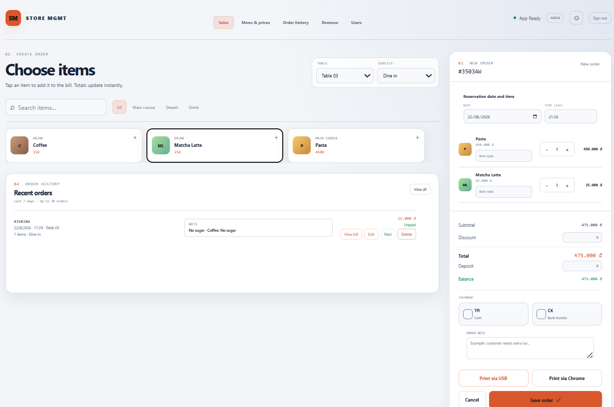
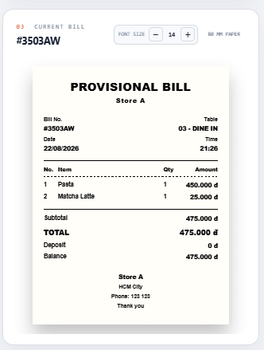
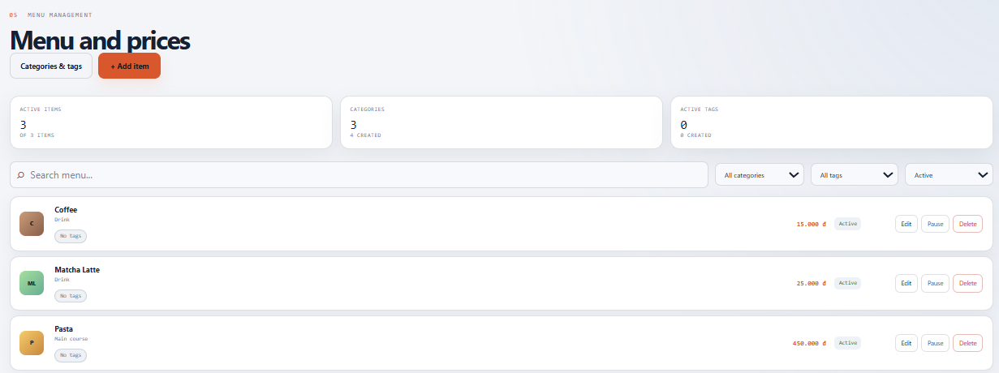
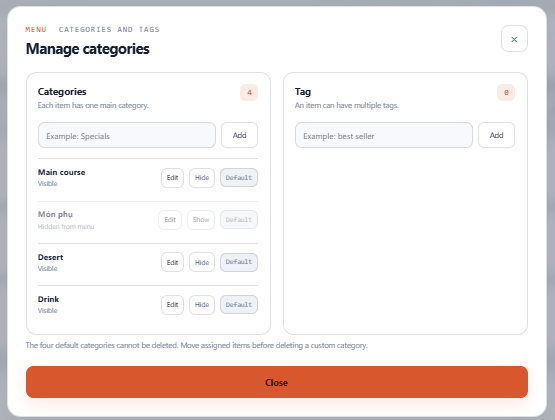
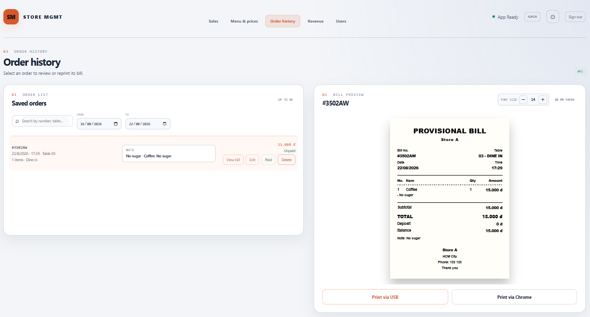
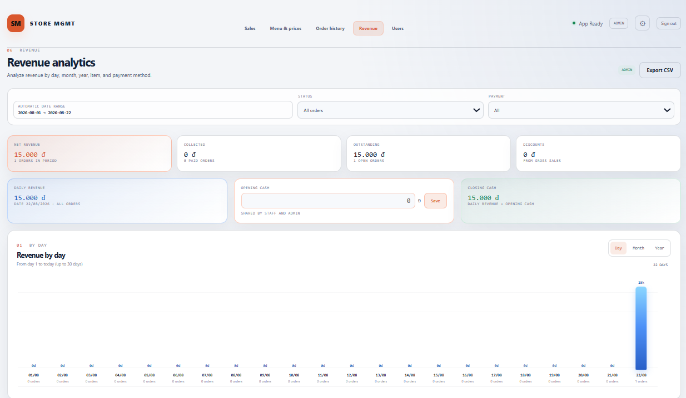

[English](README.md) | [Tiếng Việt](README.vi.md)

# Store MGMT Community Edition

[](https://github.com/atgsolution/store-mgmt-community/actions/workflows/docker-smoke.yml)
[](LICENSE)

**Hệ thống POS và quản lý self-hosted cho cửa hàng nhỏ, quán cà phê và nhà hàng.**

Store MGMT Community Edition kết hợp bán hàng trên trình duyệt, quản lý menu và đơn hàng, báo cáo doanh thu và in bill 80 mm với dữ liệu PostgreSQL tập trung trên hạ tầng do bạn quản lý.


**[Xem video sản phẩm đầy đủ](https://github.com/atgsolution/store-mgmt-community/releases/download/v1.0.1/store-mgmt-guide.mp4)** · [Bản phát hành mới nhất](https://github.com/atgsolution/store-mgmt-community/releases/latest) · [Lộ trình](ROADMAP.md) · [Thảo luận](https://github.com/atgsolution/store-mgmt-community/discussions)

## Khởi động nhanh

Yêu cầu máy chủ Linux có Docker Engine, Docker Compose v2, Git và OpenSSL.

```bash
git clone https://github.com/atgsolution/store-mgmt-community.git
cd store-mgmt-community
bash scripts/setup-linux.sh
docker compose up -d --build
```

Mở `http://localhost:6086` trên máy chủ hoặc `http://<địa-chỉ-máy-chủ>:6086` từ thiết bị cùng mạng. Script thiết lập sẽ yêu cầu tạo mật khẩu cho `admin` và `staff`, sinh mật khẩu database riêng và chỉ lưu hash scrypt của mật khẩu tài khoản. Dự án không có mật khẩu mặc định công khai.

## Phù hợp với ai?

- Cửa hàng độc lập cần quy trình bán hàng và quản lý đơn đơn giản trên trình duyệt.
- Quán cà phê và nhà hàng sử dụng bàn, tại chỗ hoặc mang đi, tiền cọc, giảm giá và bill 80 mm.
- Nhóm nhỏ muốn dùng chung dữ liệu trên máy tính hoặc máy tính bảng nhưng không phụ thuộc nền tảng SaaS.
- Đơn vị có thể tự vận hành máy chủ Linux, Docker, backup và HTTPS.

Nếu cần vận hành nhiều cửa hàng, tích hợp thanh toán hoặc fiscal theo quy định, quản lý nguyên liệu hay màn hình bếp, hãy xem [giới hạn hiện tại](#giới-hạn-hiện-tại) trước khi triển khai.

## Chức năng chính

- Giao diện bán hàng thân thiện với cảm ứng trên máy tính và máy tính bảng.
- Quản lý món, loại món, tag, giá bán và trạng thái kinh doanh.
- Quản lý bàn, hình thức phục vụ, tiền cọc, giảm giá, phương thức thanh toán và ghi chú đơn.
- Phân quyền Staff/Admin, khóa chỉnh sửa đơn Paid và ghi audit log quản trị.
- Doanh thu ngày, tháng, năm; cơ cấu thanh toán; món bán chạy; tiền đầu và cuối ca.
- In bill nhiệt 80 mm qua hộp thoại in của trình duyệt hoặc WebUSB ESC/POS trực tiếp.
- Giao diện và bill bằng tiếng Việt hoặc tiếng Anh; dữ liệu ứng dụng sử dụng UTF-8.
- Dữ liệu PostgreSQL dùng chung cho các phiên đăng nhập trên nhiều thiết bị.

## Giao diện

| Bán hàng và quản lý đơn | Xem trước bill 80 mm |
|---|---|
|  |  |
| Quản lý món và giá | Quản lý loại món và tag |
|  |  |
| Lịch sử đơn và in lại bill | Phân tích doanh thu |
|  |  |

## Giới hạn hiện tại

- Một cửa hàng trên mỗi deployment; chưa hỗ trợ multi-store hoặc multi-tenant.
- Chưa tích hợp card terminal hoặc payment processing. Ứng dụng hiện chỉ ghi nhận phương thức thanh toán.
- Chưa có fiscalization, e-invoice hoặc tích hợp kế toán.
- Chưa có inventory deduction theo recipe/BOM.
- Chưa có kitchen display system (KDS).

## Đặc tính triển khai

| Thuộc tính | Thiết kế |
|---|---|
| Phạm vi | Một cửa hàng trên mỗi deployment |
| Nguồn dữ liệu | PostgreSQL dùng chung cho mọi phiên đăng nhập |
| Lưu trữ | Database vận hành 60 ngày, archive database và long-term archive đã nén |
| Phiên đăng nhập | Tối đa 10 phiên cho mỗi tài khoản, thời hạn 7 ngày |
| Triển khai | Docker Compose gồm web, API, archive worker và các dịch vụ database |
| Máy in | Hộp thoại in của trình duyệt hoặc WebUSB ESC/POS trực tiếp |

## Quản lý tài khoản

### Đổi mật khẩu

Đăng nhập bằng `admin`, mở tab **Người dùng**, nhập và xác nhận mật khẩu mới cho `admin` hoặc `staff`, sau đó chọn **Đổi mật khẩu**. Khi đổi mật khẩu, các phiên còn lại của tài khoản sẽ bị thu hồi.

Nếu không còn phiên Admin, chạy lệnh sau trong thư mục dự án khi các container đang hoạt động:

```bash
bash scripts/reset-password.sh admin
# hoặc
bash scripts/reset-password.sh staff
```

Lệnh chỉ đổi mật khẩu tài khoản được chọn, thu hồi phiên và ghi audit log. Đơn hàng, menu và cấu hình cửa hàng không bị xóa.

## Cập nhật

```bash
git pull --ff-only
docker compose up -d --build --remove-orphans
docker compose ps
```

Việc tạo lại container vẫn giữ các Docker data volume. Không chạy `docker compose down -v` trên hệ thống có dữ liệu cần giữ.

## Backup và restore

```bash
docker compose exec -T hot-db \
  pg_dump -U store_mgmt -d store_mgmt_hot > hot-backup.sql

docker compose exec -T archive-db \
  pg_dump -U store_mgmt -d store_mgmt_archive > archive-backup.sql
```

Bộ dữ liệu phục hồi đầy đủ gồm hai database dump và volume long-term archive. Chỉ xem backup là hợp lệ sau khi restore thử thành công; xem [kiến trúc dữ liệu](docs/database.md) để biết chi tiết vòng đời lưu trữ.

## Bảo mật

- Mật khẩu tài khoản dùng scrypt với salt ngẫu nhiên.
- Hệ thống production nên chạy sau HTTPS reverse proxy với `COOKIE_SECURE=true`.
- Phân quyền và quy tắc nghiệp vụ được thực thi tại API.
- Báo cáo vấn đề bảo mật theo [chính sách bảo mật](SECURITY.md), không đăng issue công khai.

## Minh bạch dự án

Store MGMT Community Edition do maintainer trực tiếp xây dựng và duy trì, với sự hỗ trợ đáng kể từ OpenAI Codex trong quá trình phát triển. Maintainer chịu trách nhiệm về kiến trúc, code review, kiểm thử, quyết định bảo mật và release.

## Góp ý từ vận hành thực tế

Phản hồi từ môi trường đang sử dụng có giá trị hơn yêu cầu tính năng chung chung. Hãy dùng [Discussions](https://github.com/atgsolution/store-mgmt-community/discussions) cho góp ý vận hành và [Issues](https://github.com/atgsolution/store-mgmt-community/issues) cho lỗi có thể tái hiện, đặc biệt về:

- model máy in, kiểu kết nối, trình duyệt và kết quả bill in ra;
- hoạt động đồng bộ khi nhiều máy tính hoặc máy tính bảng dùng chung deployment;
- quy trình backup và restore đã được kiểm chứng thực tế;
- workflow bán hàng, quản lý đơn, ca làm việc hoặc báo cáo còn thiếu.

Hãy ghi rõ phiên bản và môi trường triển khai, nhưng không đăng thông tin đăng nhập, file `.env` hoặc database dump.

## Tài liệu

- [Kiến trúc phần mềm](docs/architecture.md)
- [Kiến trúc và vòng đời dữ liệu](docs/database.md)
- [Kiến trúc in bill nhiệt](docs/printer-setup.md)
- [Lộ trình phát triển](ROADMAP.md)
- [Hướng dẫn đóng góp](CONTRIBUTING.md)
- [Quy tắc cộng đồng](CODE_OF_CONDUCT.md)

Phát hành theo [Apache License 2.0](LICENSE).
